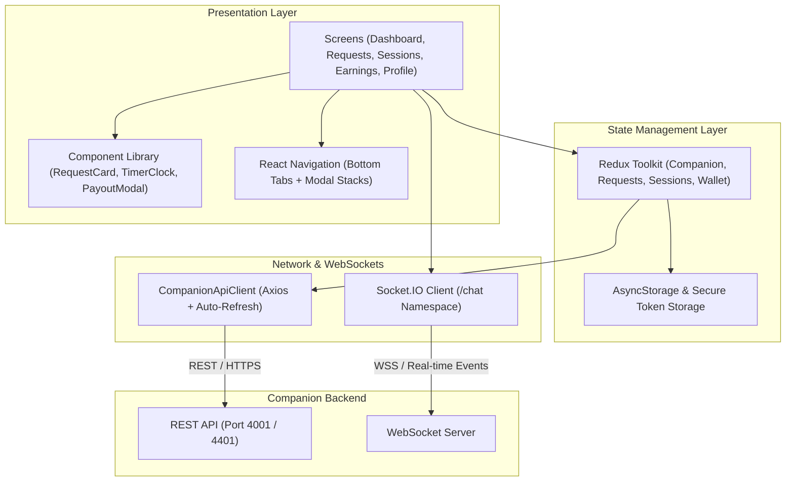
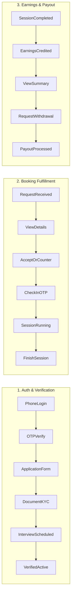

# CoBuddy Companion Mobile Application — React Native & TypeScript

[](https://reactnative.dev/)
[](https://www.typescriptlang.org/)
[](https://redux-toolkit.js.org/)
[](https://reactnavigation.org/)
[](LICENSE)

The **CoBuddy Companion Mobile App** is the dedicated supply-side mobile application empowering verified companions on the CoBuddy platform. Built with **React Native** and **TypeScript**, the app provides end-to-end tooling for managing companion applications, profile rates and portfolios, accepting or counter-offering customer booking requests, tracking in-person sessions with meeting check-ins, monitoring net earnings, and requesting automated bank payouts.

---

## Table of Contents

- [1. Mobile Architecture & Component Design](#1-mobile-architecture--component-design)
- [2. Screen Flows & Core Companion Journeys](#2-screen-flows--core-companion-journeys)
- [3. Deep Technical Modules](#3-deep-technical-modules)
  - [3.1 Request & Counter-Offer Engine](#31-request--counter-offer-engine)
  - [3.2 In-Person Session Clock & OTP Check-In](#32-in-person-session-clock--otp-check-in)
  - [3.3 Earnings Dashboard & Payout Withdrawals](#33-earnings-dashboard--payout-withdrawals)
  - [3.4 Safety & SOS Emergency Dispatch](#34-safety--sos-emergency-dispatch)
- [4. Project Structure](#4-project-structure)
- [5. Navigation Graph](#5-navigation-graph)
- [6. API Client & Networking Layer](#6-api-client--networking-layer)
- [7. Local Setup & Build Guide](#7-local-setup--build-guide)
- [8. Quality Assurance & Test Standards](#8-quality-assurance--test-standards)

---

## 1. Mobile Architecture & Component Design



---

## 2. Screen Flows & Core Companion Journeys



---

## 3. Deep Technical Modules

### 3.1 Request & Counter-Offer Engine

* **Inbound Request Processing**: Renders booking cards with customer photo, verified status, meeting activity, venue location, requested duration, and expected net earnings.
* **Counter-Offer Modal**: Allows companions to adjust requested duration or propose an alternative verified venue when scheduling conflicts arise.
* **Auto-Expiration**: Visual countdown timers notify companions before incoming requests expire (15-minute response SLA).

### 3.2 In-Person Session Clock & OTP Check-In

* **Meeting Verification**: Meeting sessions cannot start until both companion and customer enter the 4-digit check-in PIN displayed on the booking record.
* **Live Session Clock**: Displays a persistent high-precision session countdown timer with background recovery.
* **Session Finalization**: Companions conclude the session upon completion, triggering immediate S2S settlement and earnings release.

### 3.3 Earnings Dashboard & Payout Withdrawals

* **Transparent Breakdown**: Displays gross booking revenue, platform fee deduction (15%), and net companion payout (85%).
* **Payout Request Workflow**: Companions with available balance can trigger bank withdrawals directly to verified UPI IDs or bank accounts via atomic backend transactions.

### 3.4 Safety & SOS Emergency Dispatch

* **Panic Button**: Instant-access SOS trigger button accessible on all session screens.
* **Telemetry Collection**: Automatically queries GPS coordinates from device location sensors and dispatches emergency payloads to the backend and Admin Safety Operations.

---

## 4. Project Structure

```text
CoBuddyCompanion/
├── android/                       # Native Android project
├── ios/                           # Native iOS project
├── src/
│   ├── assets/                    # Icons, illustrations, brand assets
│   ├── components/                # Reusable UI component library
│   │   ├── common/                # Buttons, Inputs, Modals, Badges
│   │   ├── dashboard/             # StatCard, OnlineToggle, EarningsSummary
│   │   ├── requests/              # RequestCard, CounterOfferModal
│   │   └── sessions/              # ActiveSessionBanner, CheckInModal
│   ├── config/
│   │   └── env.ts                 # API URLs & backend host switcher
│   ├── navigation/                # React Navigation configuration
│   │   ├── AppNavigator.tsx       # Root router
│   │   └── MainTabNavigator.tsx   # Dashboard, Requests, Sessions, Earnings, Profile
│   ├── screens/                   # Screen components
│   │   ├── auth/                  # LoginScreen, OTPVerificationScreen
│   │   ├── onboarding/            # ApplicationForm, KycUploadScreen
│   │   ├── dashboard/             # DashboardScreen, StatusToggle
│   │   ├── requests/              # RequestsScreen, RequestDetailScreen
│   │   ├── sessions/              # SessionsScreen, ActiveSessionScreen
│   │   ├── earnings/              # EarningsDashboardScreen, PayoutScreen
│   │   └── profile/               # ProfileScreen, EditRatesScreen
│   ├── services/                  # API client & socket connections
│   │   ├── api/                   # Companion API service definitions
│   │   └── socket/                # Chat socket listener
│   ├── store/                     # Redux slices and stores
│   └── theme/                     # Typography, dark palette, spacing
├── __tests__/                     # Jest unit test suites
├── App.tsx                        # Main application entry component
├── package.json                   # Dependencies & npm scripts
└── tsconfig.json                  # TypeScript compiler settings
```

---

## 5. Navigation Graph

```text
AppNavigator
 ├── AuthStack
 │    ├── LoginScreen
 │    └── OTPVerificationScreen
 ├── OnboardingStack
 │    ├── ApplicationFormScreen
 │    ├── DocumentKycScreen
 │    └── VerificationPendingScreen
 ├── MainTabNavigator (Bottom Tabs)
 │    ├── DashboardScreen (Tab 1)
 │    ├── RequestsScreen (Tab 2)
 │    ├── SessionsScreen (Tab 3)
 │    ├── EarningsScreen (Tab 4)
 │    └── ProfileScreen (Tab 5)
 └── DetailModals
      ├── RequestDetailModal
      ├── CounterOfferModal
      └── PayoutRequestModal
```

---

## 6. API Client & Networking Layer

* **Base URL Resolution**: Connects to `http://10.0.2.2:4001/api/v1` on Android Emulators or remote staging/production endpoints.
* **Session Authorization**: Automatically injects Companion JWT access tokens on every request.
* **Token Rotation**: Transparently refreshes expired sessions using background refresh token exchanges without disrupting user workflows.

---

## 7. Local Setup & Build Guide

### Prerequisites
* Node.js $\ge$ 20.x
* JDK 17 & Android Studio
* Xcode $\ge$ 15 (macOS)
* React Native CLI

### Setup Instructions

1. **Install Dependencies**:
   ```bash
   cd CoBuddyCompanion
   npm install
   ```

2. **Configure Environment Variables**:
   Create `.env` in the project root:
   ```env
   COMPANION_API_URL=http://10.0.2.2:4001/api/v1
   SOCKET_URL=http://10.0.2.2:4001
   ENABLE_LOGGING=true
   ```

3. **Start Metro Bundler**:
   ```bash
   npm start
   ```

4. **Launch on Android**:
   ```bash
   npm run android
   ```

5. **Launch on iOS**:
   ```bash
   npm run ios
   ```

---

## 8. Quality Assurance & Test Standards

```bash
# Run unit tests
npm test

# Run TypeScript type check
npx tsc --noEmit
```
* **Current Status**: **100% test pass rate, 0 compiler errors**.
